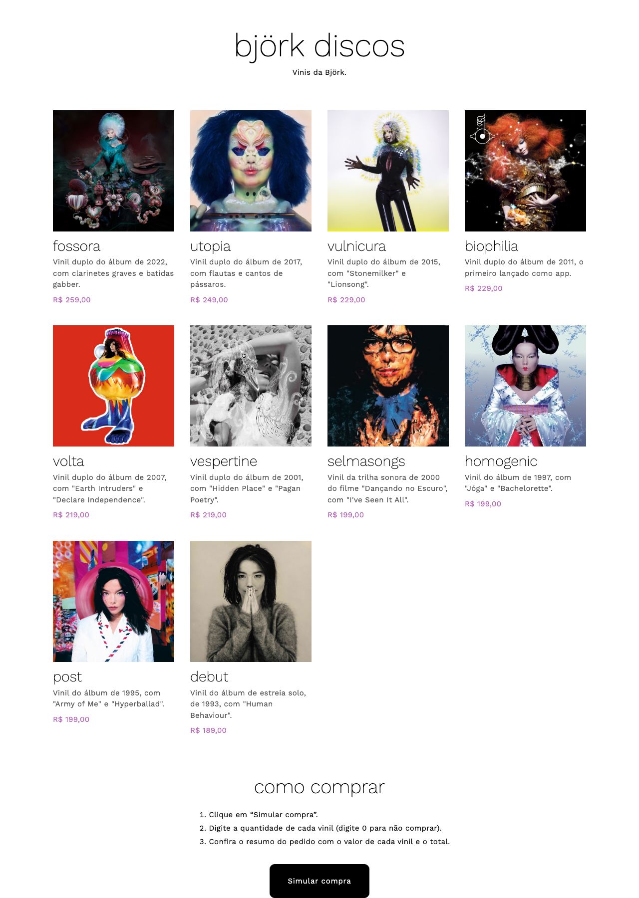

# Björk Discos — Simulador de Compras

- **Aluno:** Arthur Marinho
- **Trilha:** Desenvolvimento Mobile
- **Desafio:** Desafio 1 — Minha Loja: Simulador de Compras

## A loja

A **Björk Discos** é uma loja de discos fictícia especializada nos vinis da artista Björk.

| Produto | Descrição | Preço |
|---|---|---|
| Fossora | Vinil duplo do álbum de 2022 | R$ 259,00 |
| Utopia | Vinil duplo do álbum de 2017 | R$ 249,00 |
| Vulnicura | Vinil duplo do álbum de 2015 | R$ 229,00 |
| Biophilia | Vinil duplo do álbum de 2011 | R$ 229,00 |
| Volta | Vinil duplo do álbum de 2007 | R$ 219,00 |
| Vespertine | Vinil duplo do álbum de 2001 | R$ 219,00 |
| Selmasongs | Vinil da trilha sonora de 2000 do filme "Dançando no Escuro" | R$ 199,00 |
| Homogenic | Vinil do álbum de 1997 | R$ 199,00 |
| Post | Vinil do álbum de 1995 | R$ 199,00 |
| Debut | Vinil do álbum de 1993 | R$ 189,00 |

## Tecnologias

- HTML (estrutura da página)
- CSS (layout com grid e identidade visual, fonte [Work Sans](https://fonts.google.com/specimen/Work+Sans) do Google Fonts)
- JavaScript (`prompt()`, `Number()`, `alert()`, lista de produtos percorrida com `for...of`)

## Como executar

1. Clone ou baixe o repositório.
2. Abra o arquivo `index.html` no navegador (duplo clique).
3. Clique em **Simular compra** e digite a quantidade de cada produto.

## Estrutura

```
index.html   → página da loja
style.css    → estilos
script.js    → função simularCompra()
assets/      → capas dos álbuns e captura de tela
```

## Créditos das imagens

As capas dos álbuns pertencem à Björk e às suas gravadoras e são usadas apenas para fins educacionais. Elas foram obtidas na Apple Music, exceto a de Homogenic, que veio da Wikipédia.

## Captura de tela



## Testes realizados

Testei manualmente no navegador:

| Entrada (na ordem da página, do mais novo para o mais antigo) | Resultado esperado | OK |
|---|---|---|
| 1 de cada | Total R$ 2.190,00 | ✅ |
| 1 Homogenic, o resto 0 | Total R$ 199,00 | ✅ |
| Tudo 0 | "Nenhum produto foi selecionado." | ✅ |
| abc no primeiro | "Quantidade inválida" | ✅ |
| -1 no primeiro | "Quantidade inválida" | ✅ |

## Dificuldade e aprendizado

Aprendi que o `Number()` transforma texto inválido em `NaN` e o resultado do cálculo ficava "NaN"; aprendi a validar com `Number.isInteger()` antes de calcular. Também aprendi a usar `toLocaleString("pt-BR")` para mostrar os valores no formato brasileiro, como R$ 1.234,00. Também aprendi bastante sobre CSS durante o desenvolvimento, como o uso de `grid-template-columns` para criar telas responsivas que ajustam automaticamente a quantidade de colunas de acordo com o espaço disponível na tela, tornando o site mais adaptável a diferentes telas.

## Uso de IA

Utilizei o ChatGPT para me ajudar a desenvolver o CSS do site, buscando deixá-lo o mais próximo possível do visual do site bjork.com. A partir da análise do site oficial, eu identifiquei que os títulos e textos utilizam a fonte AvusPro, enquanto a tipografia base é a Aktiv Grotesk, ambas disponíveis mediante licença paga na Adobe Fonts. Ao pedir uma alternativa gratuita, ele me recomendou a fonte Work Sans, do Google Fonts, preservando a identidade visual com títulos em letras minúsculas e peso leve, espaçamento entre letras no corpo do texto, cor de destaque roxa e botões com cantos arredondados. Além disso, utilizei o ChatGPT para revisar o código e o README do projeto, identificando possíveis melhorias no código, nos erros de ortografia e na incongruência dos dados.
